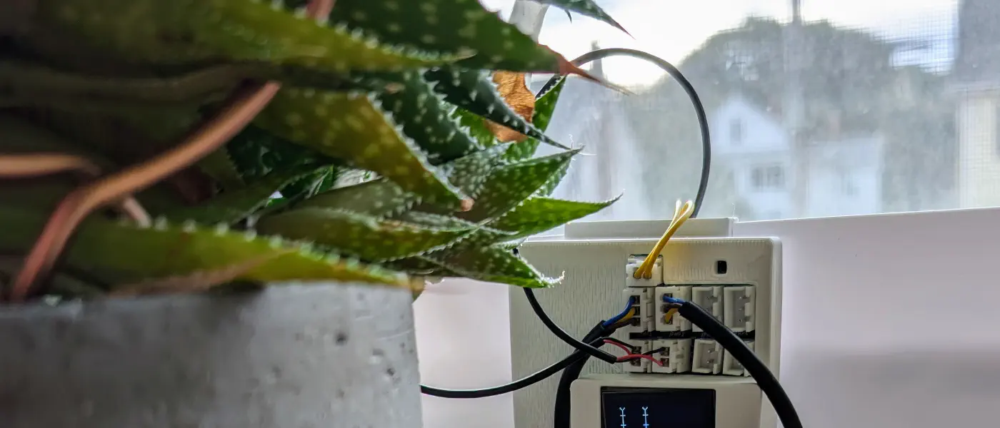
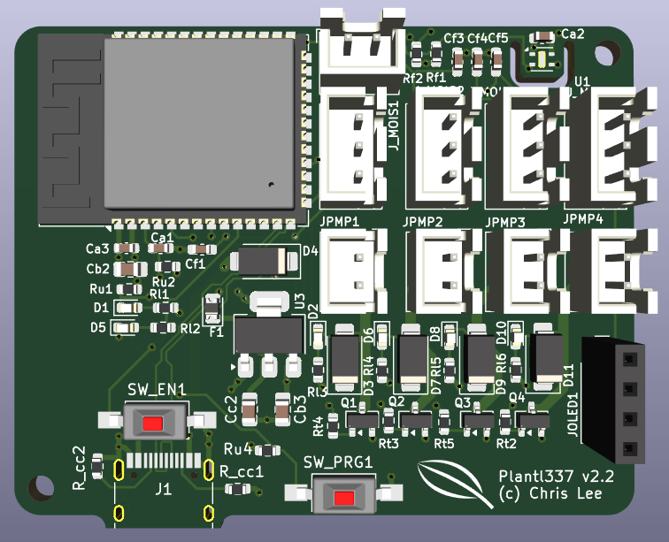
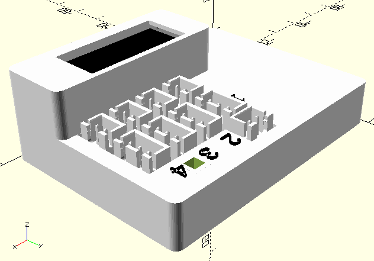
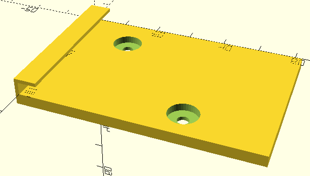
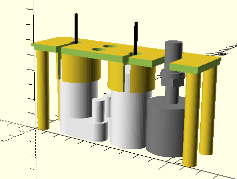
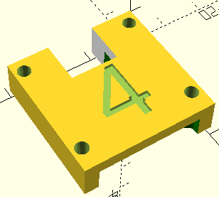
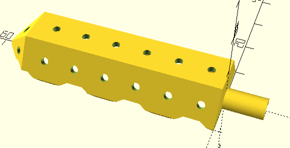

# Plant133

This is a full distribution of the Plant133 plant-watering device. This device can monitor and water up to 4 plants at a time. This repository hosts the firmware, PCBA design, and OpenSCAD code for all components.

A writeup about this project is at "[Plant1337: "Water 4 plants](https://selectiveappeal.org/posts/plant1337/)."



## Features

*   **Multi-Plant Support**: Monitors and independently waters up to 4 plants.
*   **Sensors**:
    *   Capacitive soil moisture sensing for each plant.
    *   SHTC3 temperature and humidity sensor for environmental monitoring.
    *   Reservoir water level float switch detection.
*   **User Interface**:
    *   **OLED Screen**: Rotates through status screens showing IP address, moisture levels, and environment data.
    *   **Web Dashboard**: A modern Svelte-based responsive web interface for real-time monitoring and configuration.
*   **Integration**:
    *   **MQTT**: Full support for Home Assistant (auto-discovery and state reporting) and Adafruit IO (with SSL/TLS, NTP time sync, and feed rate-limiting).
*   **Safety**:
    *   **Watchdog Timer**: Hardware watchdog protects against system hangs.
    *   **Dose Limiting**: Prevents over-watering by limiting the maximum number of pump cycles per day.
    *   **Reservoir Check**: Prevents pump damage by detecting low water levels.

## Usage

Please see the [instructions](instructions.md) for how to assemble and set up a Plant133 device hardware.

## Development

### Prerequisites
*   [PlatformIO](https://platformio.org/) (Core or VSCode extension)
*   [Node.js](https://nodejs.org/) (for building the web interface)

### Building and Flashing Firmware

1.  **Configure Secrets and Local Environment**:
    *   Copy `secrets.ini.example` to `secrets.ini` and set your WiFi credentials, OTA password, and MQTT details.
    *   Copy `local.ini.example` to `local.ini` and configure your target board environment (e.g., `usb_v20` for ESP32-S3 Board v2.x, or `usb_spider` for ESP32 Board v1.x).
2.  **One-time setup for building the web interface**:
    ```bash
    cd svelte
    npm install
    ```
3.  **Run Quality Checks and Unit Tests**:
    ```bash
    ./util/check.sh
    ```
4.  **Build the Web Interface and Firmware**:
    ```bash
    # For Board v2.x (ESP32-S3)
    pio run -e usb_v20

    # Or for Board v1.x (Classic ESP32)
    pio run -e usb_spider
    ```
5.  **Upload Firmware**:
    ```bash
    pio run -e usb_v20 -t upload
    ```

## API Reference

The device exposes a JSON API for integration and control:

*   `GET /api/status`: Returns system status (temperature, humidity, water level, pump time remaining, MQTT connection, software & hardware versions).
*   `GET /api/plants`: Returns configuration and status for all plants.
*   `PUT /api/plants/{id}`: Updates configuration for a specific plant (`1`–`4`).
*   `GET /api/moisture`: Returns current moisture readings, raw ADC counts, dose counts, and watering states.
*   `GET /api/wifi` / `PUT /api/wifi`: Get or update WiFi SSID and board name (triggers device restart on update).
*   `GET /api/mqtt` / `PUT /api/mqtt`: Get or update MQTT configuration (host, port, mode, SSL/TLS, credentials).
*   `POST /test/pump`: Run a pump for a specific duration (JSON body: `{ "pumpId": 1, "duration": 1000 }`).
*   `POST /api/restart`: Restart the device.

## Software Libraries

This project is built using a custom C++ framework for ESP devices:
- [og3](https://github.com/chl33/og3): Application framework.
- [og3x-oled](https://github.com/chl33/og3x-oled): OLED screen support.
- [og3x-shtc3](https://github.com/chl33/og3x-shtc3): SHTC3 sensor support.
- [svelteesp32](https://github.com/BCsabaEngine/svelteesp32): Web interface integration.

## Hardware

### PCBA

The full [KiCAD](https://www.kicad.org/) project and bill of materials ([KiCAD/Plant133.csv](KiCAD/Plant133.csv)) for the printed circuit board are in the [KiCAD](KiCAD/) subdirectory. Board v2.x uses an `ESP32-S3-WROOM-1-N8R2` module with native USB-C and onboard boot/reset buttons (legacy v1.2/v1.3 ESP32 boards are also supported via build flags).



### 3D Printed Components

Components are designed in [OpenSCAD](https://openscad.org/). Source code and STL models are in the [scad](scad/) subdirectory.

#### Project Box
Housing for the PCBA, OLED support bracket, and test fixture ([scad/box/](scad/box/)).


#### Reservoir Cover
Covers the water reservoir with cutouts for the EBox, tubing, and wires ([scad/reservoir_cover/](scad/reservoir_cover/)).

#### Reservoir Hanger
Mounts the box to a water reservoir ([scad/ebox_hook/](scad/ebox_hook/)).


#### Reservoir Insert
Holds pumps and water level float ([scad/reservoir_insert/](scad/reservoir_insert/)).


#### Solder Stencil Fixture
Alignment fixture and edge-support frame for applying solder paste with a PCB stencil ([scad/stencil_fixture/](scad/stencil_fixture/)).

#### Moisture Sensor Cap
Holds the watering tube at the sensor location ([scad/moisture_sensor_cap/](scad/moisture_sensor_cap/)).


#### Watering Spike
Alternative watering method using a soil spike ([scad/spike/](scad/spike/)).

